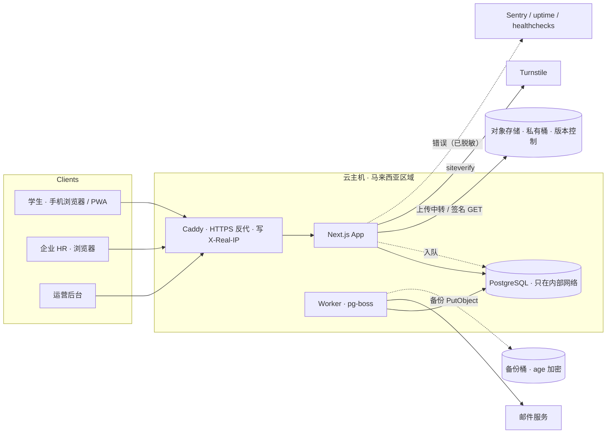

# 技术架构

> v0.2 · 2026-11-03 · FindMYJob。与 PRD 冲突时以 PRD 为准；决策和例外记在 DECISIONS。

## 1. 原则
- **单体优先**：1–2 人维护。一个 Next.js 全栈应用 + 一个 worker + 一个 PostgreSQL，足够支撑到数万用户。
- **业务规则集中在 service 层**：页面和接口只做参数校验、调用 service。权限和隐私判断全部在 service 里，方便测试。
- **配置驱动商业化**：价格、点数、额度、上限、开关都放在 SystemSetting，转收费不改代码。
- **数据放在马来西亚**：数据库、文件存储和备份都放在马来西亚区域；其他子处理者见 `SUBPROCESSORS.md`。
- **确定性闸门优先**：红线靠 ESLint、db:check、CI 和测试拦截，不靠模型自觉。

## 2. 技术栈

| 层 | 选择 | 备注 |
|---|---|---|
| 语言 | TypeScript（strict） | |
| 框架 | Next.js（App Router，当前稳定版） | 页面 + Server Actions + Route Handlers |
| UI | Tailwind CSS + shadcn/ui + lucide-react | 移动端优先；弹窗只用 shadcn Dialog / Sheet；中文只用系统字体栈 |
| 表单 / 校验 | react-hook-form + zod | zod schema 前后端共用 |
| ORM / 数据库 | Prisma 6 + PostgreSQL 16 | `prisma` 和 `@prisma/client` 锁同一个 6.x 精确版本，不升 7；Postgres 镜像写精确 tag（`postgres:16.x-bookworm`） |
| 认证 | Better Auth（邮箱 + 密码、邮箱验证码） | 角色存在 `User.role`；加固基线见 §5.11 |
| 人机验证 | Cloudflare Turnstile | 4 个认证入口服务端校验，见 §5.8 |
| 国际化 | next-intl（zh / en，之后加 ms） | html lang：zh-Hans / en |
| 文件 | S3 兼容对象存储（私有桶、开启版本控制） | 上传经 app 中转（D17），下载用 ≤ 300 秒的签名 GET；本地开发用 MinIO |
| 邮件 | 通过 `EmailProvider` 接口抽象；生产用 Resend 或 AWS SES | 本地开发用 Mailpit |
| 后台任务 | pg-boss（基于 Postgres 的队列和定时任务） | M0 就启动 worker（M0-T11） |
| PDF | pdf-lib | 页数检查、copyPages 重建、简历水印 |
| 测试 | Vitest（单元 / 集成，连真实测试库）+ Playwright（E2E） | 合成数据用 @faker-js/faker（锁精确版本） |
| 监控 | Sentry（只收错误，不带 PII）+ pino 日志 + `/api/health` + 外部 uptime + healthchecks | 见 §5.13 |
| 部署 | Docker Compose（app + worker + postgres + caddy），马来西亚区域云主机 | 人工 SSH 执行 `findmyjob-deploy`，见 §7、DECISIONS D1/D24 |
| CI | GitHub Actions：verify（db:check → lint → typecheck → test → build）、e2e、guard、gitleaks、pnpm audit | 不调用 LLM，不引用 secrets |
| 包管理 | pnpm（corepack，`packageManager` 写精确版本） | 原型仍用 npm（A13） |
| AI（M9） | Claude API 做简历解析、JD 生成；pgvector 做语义匹配 | 模型 ID 放环境变量 |

## 3. 架构图



## 4. 目录结构

```
.
├─ CLAUDE.md
├─ env.example                    环境变量模板（不以 .env 开头，见 A14）
├─ .gitignore / .dockerignore / .gitattributes
├─ .githooks/pre-commit           gitleaks 扫暂存区
├─ .gitleaks.toml                 自定义秘密规则（M0-T09）
├─ .claude/                       settings.json、security-guidance 规则、项目技能 prisma-migrations
├─ docs/                          PRD / ARCHITECTURE / TASKS / DECISIONS / RUNBOOK / CAPACITY / AI-SKILLS / SUBPROCESSORS
│  └─ security/                   threat-model.md、FINDINGS.md（只写编号、位置、状态）
├─ prisma/                        schema.prisma, migrations/, seed.ts, seed-load.ts, seed-data/companies.example.json
├─ docker/postgres/               roles.sql, db-setup.sql, initdb.d/10-init.sh
├─ deploy/                        Dockerfile, docker-compose.prod.yml, Caddyfile
│  └─ server/                     findmyjob-deploy, findmyjob-backup, 00-findmyjob-hardening.conf, daemon.json
├─ scripts/
│  ├─ auto-build.sh, auto_build_status.py, unattended.md, mcp-none.json, headless-settings.json   无人值守开发（人维护）
│  ├─ db/                         check.sh, apply-roles.sh, restore-drill.sh, verify-decrypt.ts
│  ├─ backfill/                   数据回填脚本（按主键分批）
│  └─ import-companies.ts         公司名单导入（真实名单放在仓库外，由人运行）
├─ load/k6/                       browse-search.js, smoke.js（P1：unlock / upload / apply）
├─ src/
│  ├─ app/
│  │  ├─ [locale]/(public)/       首页、职位、企业主页、合作伙伴、定价、法律页、反诈专区
│  │  ├─ [locale]/(auth)/         登录、注册、重置密码
│  │  ├─ [locale]/s/              学生端（含额度与邀请页、数据导出页）
│  │  ├─ [locale]/e/              企业端
│  │  ├─ [locale]/admin/          运营后台
│  │  └─ api/                     auth、uploads/[purpose]、resumes、logos、webhooks、health
│  ├─ components/                 ui/ 下是 shadcn 组件
│  ├─ lib/ime.ts                  isImeComposing（客户端，输入法组字判断）
│  ├─ server/
│  │  ├─ db.ts                    Prisma client 单例
│  │  ├─ action.ts / route.ts     Server Action 和 Route Handler 的唯一包装（auth + zod + 错误映射）
│  │  ├─ auth.ts                  Better Auth 配置、getSession
│  │  ├─ authz.ts                 requireUser / requireStudent / requireCompanyMember(minRole) / requireVerifiedCompany / requireAdmin
│  │  ├─ errors.ts                AppError 及子类
│  │  ├─ services/                每个文件一个领域：
│  │  │     student-profile, school-verification, company, team, talent-search, talent-visibility, talent-view,
│  │  │     contact-access, credits, unlock, jobs, job-search, job-view-quota, applications, invitations,
│  │  │     referrals, signup-cap, managed-company, reports, articles, notifications, settings, audit,
│  │  │     admin-users, billing, data-rights
│  │  ├─ serializers/             talent-card.ts（企业侧学生数据的唯一出口）、job.ts（toJobListItem 白名单）
│  │  ├─ jobs/                    pg-boss 任务定义 + registry.ts
│  │  └─ lib/                     crypto, storage, email, rate-limit, redact, watermark, mask-name, turnstile,
│  │                              client-ip, logger, alert, advisory-locks, taxonomy/industries
│  ├─ i18n/ + messages/zh.json, messages/en.json
│  ├─ env.ts                      环境变量 zod 校验（生产判断只看 APP_ENV）
│  ├─ middleware.ts               粗粒度拦截 + x-request-id
│  └─ worker.ts                   worker 进程入口
├─ tests/                         unit/, integration/, e2e/, architecture/（P1）, setup/, factories.ts
├─ docker-compose.yml             本地：postgres、minio、mailpit（端口只绑 127.0.0.1）
└─ .github/                       workflows/ci.yml、dependabot.yml
```

## 5. 关键设计

### 5.1 权限
- 所有 Server Action 用 `action({ auth, input }, handler)` 包装，所有 Route Handler 用 `route(...)` 包装（唯一例外是 Better Auth 的 handler）。包装器负责：按 auth 级别取身份（public / user / student / company[verified] / admin）、zod 解析输入、`AppError` 映射成 `{ ok:false, code }`、其他错误只返回通用错误码并写日志。Server Action 一律按公开端点对待。
- `route()` 对非 GET/HEAD 请求校验 Origin，默认返回 `Cache-Control: private, no-store`。
- 会被 Next 打包的服务端模块首行写 `import 'server-only'`；`src/server/jobs/**` 和 `scripts/**` 不写，worker 和脚本用 `tsx --conditions=react-server` 启动，测试里把 `server-only` alias 成空模块。
- middleware 只做粗粒度拦截，matcher 用正向列表：`/:locale/s|e|admin/:path*` 和 `/api/:path*`，排除 `/api/auth/*` 和 `/api/health`。路径前缀对应角色：`/s` → STUDENT，`/e` → EMPLOYER，`/admin` → ADMIN。
- **细粒度判断全部在 service 层**。`require*` 每次都查库：User.status、CompanyMember、Company.isActive 和 verificationStatus，不缓存角色。企业侧所有查询都必须带 `companyId`，且 companyId 来自 `requireCompanyMember()` 的返回值，**绝不取自客户端参数**。
- 企业未认证时只能访问 `/e/onboarding`、`/e/company` 和职位草稿。
- 敏感动作（解锁、联系方式、人才详情和搜索、简历下载、点数、团队管理、admin 调整）都要在 `tests/integration/authz-matrix.test.ts` 里有越权测试行；新增敏感动作的任务负责加行。ESLint 检查 `use server` 文件只导出 `action(...)`。

### 5.2 隐私与脱敏（最重要）
- 联系方式只存在 `StudentContact`，字段用 AES-256-GCM 加密。密钥环 `PII_KEYS=v1:<base64 32 字节>[,v2:...]`，当前加密用 `PII_ACTIVE_KEY_ID`。
- 密文格式 `enc:<keyId>:<base64(iv12‖ct‖tag16)>`；iv 用 `randomBytes(12)`；AAD 为 `StudentContact.<field>:<studentId>`，密文不能在行或字段之间互换。对外只暴露 `encryptField` / `decryptField`，解密失败抛 `DecryptError`。
- 轮换：新增 v2 并设为 active，旧密钥一直保留到含旧密文的备份全部过期（30 天）后才删。密钥的存放位置见 A19。
- 只有 `services/contact-access.ts` 能调用 `decryptField`（ESLint override 保证）。企业侧入口是 `getContactForCompany(companyId, studentId)`，内部检查：存在 TalentUnlock、学生没有屏蔽该企业、学生账号未删除。学生本人读写自己的联系方式走 `getOwnContact` / `updateOwnContact`。
- 企业侧拿到的学生数据**只能**经 `serializers/talent-card.ts` 的 `toTalentCard()` / `toTalentDetail()` 输出。企业侧通知和邮件的 payload 也只放 serializer 的输出；只有已解锁或学生已投递时才放全名。
- 可见性只有一处判断：`services/talent-visibility.ts` 的 `isStudentVisibleToCompany`，搜索、详情、解锁、收藏、邀请都调用它；不满足时返回 404。
- `lib/redact.ts`：把自由文本中的邮箱、电话（+60 / 01x、+86 1xx、通用格式）、URL、微信号模式替换为「[已隐藏]」。覆盖范围：headline、summary、每个技能标签、Education 的 major 和 description、Experience 的 title、organization 和 description、结构化简历预览。
- **防泄漏测试**（必须存在，不得删除或放宽）：
  - 单元：构造一个所有 PII 字段都有值的学生，断言未解锁时序列化结果的 JSON 字符串里不出现任何 PII 值（全名、电话、邮箱、WhatsApp、微信、LinkedIn、简历 storageKey）。
  - E2E（M4-T13）：未解锁的企业访问搜索页和详情页，收集全部 HTML、RSC、JSON 响应，断言都没有哨兵值；职位侧用例见 M5-T03。

### 5.3 点数与解锁（涉及钱，必须正确）
- `CreditWallet.balance` 是缓存值；`CreditLedger` 是只追加的账本，每条都记 `balanceAfter`。只追加由数据库权限保证：首个迁移收回 `findmyjob_app` 对 CreditLedger 的 UPDATE、DELETE、TRUNCATE（§5.10）。
- 所有余额变动只能通过 `credits.ts` 的 `applyLedgerEntry(tx, {...})`，必须在事务内调用。
- 解锁事务顺序：
  1. `INSERT TalentUnlock`。唯一约束（companyId, studentId）冲突 → 回滚，返回已有记录，不扣点
  2. `updateMany CreditWallet SET balance = balance - cost WHERE companyId = ? AND balance >= cost`，影响行数 ≠ 1 → 抛 `InsufficientCreditsError`
  3. `INSERT CreditLedger`（reason=UNLOCK，refType="TalentUnlock"，refId）
  4. `INSERT AuditLog`（talent.unlock）
  5. 事务提交后入队，通知学生
- 学生投递时：如果还没有 TalentUnlock，就在同一事务里创建一条 `source=APPLICATION, creditsSpent=0` 的记录。这样「能不能看联系方式」只有一个判断依据。
- 必备测试：余额 3、并发 10 个不同学生的解锁 → 恰好 3 个成功；同一学生并发重复解锁 → 只扣 1 次。
- 每日对账任务：检查每个钱包的 balance 等于该钱包所有 ledger 的 `SUM(delta)`（同一事务写的多条记录 createdAt 可能相同，不能按「最后一条 balanceAfter」核对）。不一致时调用 `alert('wallet.mismatch', { companyId, expected, actual })`。

### 5.4 搜索
- **职位搜索**（`services/job-search.ts` 的 `searchJobs({ q, mode, filters, page })`）：
  - **EXACT**：每个词都要在 title、skills、category、公司名、行业名里出现（ILIKE + pg_trgm）。
  - **RELATED**：每个词扩展成「原词 + 同组同义词」（来自 SearchSynonymGroup，双向），命中任意一个就算。
  - **打分**：标题精确命中 100 > 标题经同义词命中 60 > skills / 类别命中 40 / 25 > 公司 / 行业 20 / 15 > 描述 10 / 5。
  - 按职位 id 去重；精确结果在前；精确结果少于 `search.relatedFallbackBelow` 时追加相关职位。
  - 公开列表只经 `serializers/job.ts` 的 `toJobListItem()` 输出，不含 description、requirements、benefits；`salaryVisible=false` 时也不含 salaryMin / salaryMax。选了薪资档时排除隐藏薪资的职位。
  - **搜索不能泄露看不到的内容**（11-03 原型的 commit 安全审查发现）：
    - 描述和要求只在查看者能打开该职位时才参与匹配和打分（`jobAccess` 为 open）；访客和额度用完的学生搜索时，只匹配标题、技能、类别、公司和行业。否则用关键词反复试探，就能猜出锁住的职位写了什么。
    - 按薪资排序时，隐藏薪资的职位一律排在最后，不参与比较；否则排序位置会暴露它的薪资区间。
- **人才库搜索**：Prisma 结构化过滤（数组 `hasSome` / `hasEvery`、范围）+ 关键词 ILIKE（专业、技能、一句话介绍、经历标题）。最多翻到 `talentSearch.maxPage` 页。
- trigram 索引写在 `schema.prisma` 里（`@@index([col(ops: raw("gin_trgm_ops"))], type: Gin)`，StudentProfile.major / headline、Job.title），`pg_trgm` 扩展在首个迁移的第一行创建；不在迁移里手写索引，否则下一次迁移会把它删掉。
- 少于 3 个字的关键词用不上 trigram，走全表扫描，试点规模下可以接受。ILIKE 的用户输入先转义反斜杠、`%` 和 `_`。
- 档案超过 5,000 条或中文分词需求明显时，引入 Meilisearch（支持中文分词），由 worker 同步数据。
- M9：pgvector 存档案 / 职位的 embedding，用于「推荐人才」「推荐职位」。

### 5.5 文件
- **上传**（D17：经 app 中转）：`/api/uploads/[purpose]` 用 `route()` 包装，读取 formData，按用途套白名单，检查文件头，全部通过后才 PutObject。对象 key 由服务端生成。每个用户每小时最多 `limits.uploadsPerHour` 次；拒收时写审计 `upload.reject`。请求体上限 11MB（Caddy 同步设置）。

  | purpose | 类型 | 大小 | 其他 |
  |---|---|---|---|
  | RESUME | pdf | ≤ 5MB | ≤ `resume.maxPages` 页；加密 PDF 拒绝；页数写入 ResumeFile.pageCount |
  | VERIFICATION | pdf / png / jpeg | ≤ 10MB | 最多 5 个；documentKeys 只能来自本企业自己的上传记录 |
  | PAYMENT_PROOF | pdf / png / jpeg | ≤ 10MB | M8 |
  | LOGO | png / jpeg | ≤ 2MB | |

  文件头：`%PDF-`、`89 50 4E 47`、`FF D8 FF`；SVG、HTML、XML 一律拒收。
- **下载**：服务端先校验权限，再生成有效期不超过 300 秒的签名 GET，带 `Content-Disposition: attachment`，文件名按 RFC 5987 编码。企业下载简历走 `/api/resumes/[id]/download`：服务端读取 PDF → 用 `PDFDocument.create()` + `copyPages()` 重建文档（丢掉 OpenAction、JavaScript、附件）→ 每页加水印 → 流式返回，不暴露原始 URL；每个企业成员同时最多 2 个水印任务。
- **Logo**：走 `/api/logos/[companyId]` 代理，设 public 长缓存（P1：M7-T17）。
- **存储桶**：私有并阻止公共访问；开启版本控制，非当前版本 30 天后过期。删除用户数据时用 ListObjectVersions + DeleteObjects 删掉全部版本。
- **Key 规则**：`resumes/{studentId}/{cuid}.pdf`、`verifications/{companyId}/{cuid}.{ext}`、`logos/{companyId}/{cuid}.{ext}`、`exports/{userId}/{cuid}.zip`。

### 5.6 后台任务（pg-boss）
- worker 在 M0 就启动（`src/worker.ts`，M0-T11），连 `WORKER_DATABASE_URL`，`connection_limit=3`、`max=4`；Next 进程里只负责 send 的实例 `max=2`，关掉维护和调度。
- pg-boss 的调度显式按 Asia/Kuala_Lumpur 写；主机上的 cron（备份等）一律按 UTC 写。

| 任务 | 触发 |
|---|---|
| `send-email` | 入队 |
| `notify` | 入队 |
| `purge-unverified` | 每小时，删除超过 `signup.unverifiedTtlHours` 仍未验证的账号 |
| `requalify-referrals` | 每天 00:15，重新判定因每日上限停在 PENDING 的邀请 |
| `pilot-monthly-credits` | 每月 1 日 00:10；`billing.enabled=true` 时跳过 |
| `expire-invitations` | 每小时 |
| `reconcile-wallets` | 每天 03:00 |
| `purge-deleted-accounts` | 每天 04:00，清理软删除满 30 天、仍有 PII 的账号（可重复执行） |
| `employer-daily-digest` | 每天 09:00，新投递汇总 |
| `expire-subscriptions`（M8） | 每天 00:30 |
| `prune-rate-limit`（P1，M7-T14） | 定期清理限流桶 |

### 5.7 必须写审计日志的动作
`auth.login`、`auth.session.revoke`、`student.visibility.change`、`talent.view`、`talent.unlock`、`talent.limit.hit`、`resume.download`、`upload.reject`、`credits.adjust`、`company.verify`、`company.reject`、`company.invite.accept`、`company.managed.create`、`company.managed.post`、`company.managed.transfer`、`job.review`、`job.report.resolve`、`referral.void`、`order.confirm`、`setting.update`、`user.suspend`、`data.export`、`data.delete`

### 5.8 安全清单
- 所有外部输入用 zod 校验，Server Actions 也不例外（经 `action()` / `route()`）。
- 认证限流用 Better Auth 的 rateLimit，存储设为 database（表由 Better Auth CLI 生成到临时文件再手工合并，保留 Timestamptz）。customRules：登录 60 秒 5 次，注册、发验证码、找回密码各 60 秒 3 次。
- 客户端 IP 只认 `X-Real-IP`（由 Caddy 写入），只经 `getClientIp()` 读取，不信 `X-Forwarded-For`（A24）。业务限流按业务表计数；内存限流只在单实例阶段用，P1 换成 PostgreSQL 限流桶（M7-T14）。
- Turnstile：服务端校验地址 `https://challenges.cloudflare.com/turnstile/v0/siteverify`，5 秒超时，超时按失败处理；校验 success、hostname 和 action；token 只能用一次；失败一律拒绝。开发环境用 Cloudflare 官方测试 key，`APP_ENV=production` 时拒绝测试 secret。
- 安全响应头（Caddy）：`X-Content-Type-Options nosniff`、`Referrer-Policy strict-origin-when-cross-origin`、`X-Frame-Options DENY`；`poweredByHeader:false`。
- HSTS 分阶段上线：先 `max-age={$HSTS_MAX_AGE:300}`，不加 includeSubDomains 和 preload；E3 前改为一年（M7-T15）。
- CSP 先用不带 nonce 的 `Content-Security-Policy-Report-Only` 收集违规；E3 前改为 nonce 强制模式（M7-T15）。
- `/s`、`/e`、`/admin`、认证页和 `/api` 设 `X-Robots-Tag: noindex, nofollow` 和 `Cache-Control: private, no-store`；这些路径和 `src/server` 里不用 `'use cache'`、`unstable_cache`、`force-static`。指向会计数页面的 Link 设 `prefetch={false}`。
- 密码哈希交给 Better Auth；会话用 httpOnly + secure cookie。
- `src/env.ts` 用 zod 校验环境变量，缺失就启动失败；生产检查只看 `APP_ENV`（production / staging / ci / development），见 A23。
- 生产环境的 postgres 不发布任何端口；本地 compose 的端口一律绑 127.0.0.1。
- 依赖：Dependabot（每月一次版本更新 + 安全更新照常）+ CI 里的 `pnpm audit --prod --audit-level high`。

### 5.9 查看额度
- 额度公式：`limit = base + floor(qualified / tierSize) × tierBonus + grants`；`qualified ≥ unlimitedAt` 时不限；`studentQuota.enabled=false` 时不限。参数见 PRD §5，额度只能经 `services/job-view-quota.ts` 计算和扣减。
- `openJob(studentId, jobId)` 在一个事务里：先 `lockXact(tx, LOCK_NS.JOB_VIEW_QUOTA, studentId)`，再数已用次数，再 `INSERT JobView ... ON CONFLICT DO NOTHING`。已投递、被邀请投递的职位总是允许打开，不计数。
- EMPLOYER 只能看本企业职位的详情，其他职位按访客处理（D18）。

### 5.10 数据库约定
- **角色**（`docker/postgres/roles.sql`，可以重复执行；口令通过 psql 变量传入）：

  | 角色 | 用途 | 角色级设置 |
  |---|---|---|
  | `findmyjob_owner` | 库的 owner；迁移和测试清表用 | `lock_timeout 5s`、`statement_timeout 10min`；开发环境加 CREATEDB |
  | `findmyjob_app` | app 和 worker 连接用 | `statement_timeout 30s`、`idle_in_transaction_session_timeout 30s`；只有 CONNECT、USAGE 和默认的 SELECT/INSERT/UPDATE/DELETE（不给 TRUNCATE），序列 USAGE/SELECT；schema `pgboss` 归它 |

  不用 `postgres` 超级用户跑应用（`APP_ENV=production` 时 env.ts 拒绝）。首个迁移末尾的 DO 块收回 `findmyjob_app` 对 CreditLedger 的 UPDATE、DELETE、TRUNCATE，以及对 AuditLog 的 DELETE、TRUNCATE；AuditLog 的 UPDATE 按 D22 默认也收回。
- **连接预算**：合计不超过 20（app `connection_limit=5`、worker 3、迁移和运维临时连接其余），不用 PgBouncer，不设全局 `idle_session_timeout`。
- **时间**：所有 DateTime 用 `@db.Timestamptz(3)`；数据库和主机时区都是 UTC，展示时转 Asia/Kuala_Lumpur。
- **锁**：只用 `lockXact(tx, LOCK_NS.X, id)`（`lib/advisory-locks.ts`，内部用 `$executeRaw` 执行带 `::int` 命名空间的 `pg_advisory_xact_lock`），必须在同一个 `$transaction` 里调用；能用唯一约束或带条件的 `updateMany` 解决的就不加锁；不用会话级 advisory lock。事务里不调用 S3、不发邮件、不发 HTTP 请求。
- **迁移**：只往前滚（A18）；规程见项目技能 `.claude/skills/prisma-migrations/SKILL.md`；`pnpm db:check` 在 CI 和本地都必过。
- **测试库**：`findmyjob_test` 和 `findmyjob_shadow` 归 `findmyjob_owner`；测试代码在库名不以 `_test` 结尾或主机不是本机时直接抛错。

### 5.11 Better Auth 配置基线（选项名以实际安装的版本为准，待核实）
- `baseURL`、`trustedOrigins` 设为 `APP_URL`，开发环境另加 `http://localhost:3000`；不用通配符，不设 `disableCSRFCheck`。
- `APP_ENV=production` 时 `useSecureCookies: true`；不开 `cookieCache`。
- `user.additionalFields` 里 role 和 status 设为 `input: false`；打开 `requireEmailVerification`。
- 改密码时撤销其他会话，重置密码后撤销全部会话；运营停用账号时在同一事务里删除该用户全部 Session 并写审计 `auth.session.revoke`。
- emailOTP：最多尝试 5 次，600 秒过期，以哈希形式存储。
- rateLimit 见 §5.8；`ipAddressHeaders` 设为 `x-real-ip`。
- `hooks.before` 对注册、登录、发验证码、找回密码这 4 个原始路径调用 `verifyTurnstile(token, { action })`；`databaseHooks.user.create.before` 调用 `assertStudentSignupOpen()`。
- 新增 `/api/auth` 端点前，先确认 Turnstile 和限流都覆盖到了它。P1：运营账号强制 twoFactor，敏感操作要求 10 分钟内的新鲜会话（M6-T09）。

### 5.12 滥用防护
- 注册：Turnstile + 认证限流 + 只统计已验证学生的注册上限 + 未验证 48 小时清理 + 防枚举（相同响应、提醒邮件）。
- 学校 OTP：每用户每小时 `limits.otpSendsPerHour`、每目标邮箱每天 `limits.otpSendsPerEmailPerDay`；sha256 存储，`timingSafeEqual` 比较；域名按 `@` 后整段精确匹配。
- 邀请：每日 `referral.maxQualifiedPerDay`、邮箱规范化后自邀不算、次日重新判定。
- 人才库：成员级 + 企业级每日上限、翻页上限、同一学生当天只计 1 次、触发时审计 `talent.limit.hit`。
- 团队邀请：令牌 `randomBytes(32)` + base64url，只存 sha256；绑定邮箱、只用一次、7 天过期；`team.maxMembers`。
- 上传：白名单 + 文件头 + 每小时上限 + PDF 页数和加密检查。
- 举报：每用户每天 `limits.jobReportsPerDay`。
- P1（M7-T14）：止血开关 `unlock.enabled`、`talentPool.searchEnabled`、`uploads.enabled`；`email.dailyCap`。

### 5.13 可观测性与隐私
- 日志只用 `src/server/lib/logger.ts`（pino，只输出到 stdout，不用 transport）。redact 字段：password、token、email、phone、whatsapp、wechat、linkedin、cookie、authorization，每个字段同时写顶层和 `*.` 前缀两种路径。`src/server`、`src/worker.ts`、`src/app/api` 下 `no-console` 设为 error。
- middleware 生成或透传 `x-request-id`；日志里只记路由模板、requestId 和内部 ID，不记原始 URL 和请求体。
- 告警只调用 `alert(code, ctx)`：M0 只写 `logger.error`；M3-T03 之后同时给 ADMIN 发站内通知；M7-T04 之后同时转发到 Sentry。
- Sentry（`@sentry/nextjs` 锁精确版本，worker 用 `@sentry/node`）：在 `instrumentation.ts`（register、onRequestError）和 `instrumentation-client.ts` 里初始化，三处共用 `src/lib/sentry-options.ts`：`sendDefaultPii:false`、`tracesSampleRate:0`、不开 Replay、`release` 设为 `APP_TAG`、`beforeSend` 用 `scrubEvent`（删除 cookies、data、query_string 和除 user-agent 以外的 header；URL 换成路由模板；去掉 user；message 再过一遍 redact）。不运行 `npx @sentry/wizard`。区域按 D14。
- `/api/health`：`SELECT 1`，2 秒超时，返回 `{ status, version }`，带 no-store；外部 uptime 监控它（D16）。定时任务和备份成功后 ping 各自的 healthchecks 地址。
- 日志、AuditLog.metadata、Sentry 和 Notification 里不能出现解密后的联系方式、OTP 或令牌。

## 6. 环境变量（`env.example`）

本地由人执行 `cp env.example .env` 后填假值；AI 不读、不写任何 `.env*` 文件。生产环境的值只放在主机的 `/opt/findmyjob/env/*.env`（按服务拆分：app.env、db.env、migrate.env、backup.env，权限 600、属主 deploy），不放进 GitHub Secrets。

```
APP_ENV=development          # production | staging | ci | development；生产判断只看它
APP_URL=http://localhost:3000
DATABASE_URL=                # 用户 findmyjob_app，带 connection_limit=5
MIGRATE_DATABASE_URL=        # 用户 findmyjob_owner，迁移用（Prisma directUrl）
WORKER_DATABASE_URL=         # 用户 findmyjob_app，connection_limit=3
SHADOW_DATABASE_URL=         # findmyjob_shadow，db:check 的漂移检查用
TEST_DATABASE_URL=           # findmyjob_test，用户 findmyjob_app
TEST_ADMIN_DATABASE_URL=     # findmyjob_test，用户 findmyjob_owner，只用来清表
BETTER_AUTH_SECRET=
BETTER_AUTH_URL=
PII_KEYS=                    # v1:<base64 32 字节>[,v2:...]
PII_ACTIVE_KEY_ID=v1
TURNSTILE_SITE_KEY=
TURNSTILE_SECRET_KEY=
S3_ENDPOINT=
S3_REGION=
S3_BUCKET=
S3_ACCESS_KEY_ID=
S3_SECRET_ACCESS_KEY=
EMAIL_PROVIDER=smtp          # smtp | resend | ses
EMAIL_FROM=
SMTP_URL=                    # 本地：smtp://localhost:1025（Mailpit）
RESEND_API_KEY=
SENTRY_DSN=
NEXT_PUBLIC_SENTRY_DSN=
SENTRY_ENVIRONMENT=
LOG_LEVEL=info
HSTS_MAX_AGE=300             # Caddy 读取；E3 前改为 31536000
APP_TAG=                     # 镜像 tag（40 位 sha），部署脚本写入
SEED_ADMIN_EMAIL=
SEED_ADMIN_PASSWORD=
ANTHROPIC_API_KEY=           # M9
AI_MODEL_PARSE=claude-haiku-5-5      # M9，可换 claude-sonnet-5-5
STRIPE_SECRET_KEY=           # M8
STRIPE_WEBHOOK_SECRET=       # M8
```

## 7. 部署
- **MVP**：一台马来西亚区域云主机（2 vCPU / 4GB 起，加 2G swap），Docker Compose 跑 caddy、app、worker、postgres（`deploy/docker-compose.prod.yml`）。只有 caddy 发布 80、443 和 443/udp；backend 网络设 internal，只放 postgres；app 和 worker 设 `cap_drop: ALL` 和 `no-new-privileges`；内存上限 app 1g、worker 512m、postgres 1g、caddy 128m。migrate、tools、backup 三个服务放在 profile `ops` 下。
- **发布流程**：CI 在 push 到 main 时推送 `ghcr.io/fairchan/findmyjob:<sha>` 和 `findmyjob-migrate:<sha>`（不推 latest）→ 技术负责人 `ssh <admin>@<host> sudo -u deploy /opt/findmyjob/bin/findmyjob-deploy deploy <sha> [--approve-migrations]` → pull → 有待执行迁移但没加批准参数时打印 SQL 并 exit 3 → 先做一次 pre-migrate 备份 → 用 ops 跑 migrate → `APP_TAG=<sha> up -d app worker` → 60 秒健康检查 → 成功就把 sha 和 digest 追加到 deploy-history.log，失败就回到上一个 tag 并 exit 1。迁移不回滚，回滚 = 重新部署上一个镜像 tag + 必要时写一个前滚迁移；每个迁移都必须和上一个已发布的镜像兼容。GitHub 不持有部署私钥。
- **备份**：`findmyjob-backup`（主机 cron 每天 19:15 UTC，即吉隆坡 03:15）：`pg_dump -Fc --exclude-schema=pgboss` → 管道给 `age -r <公钥>` → 写到容器挂载的普通磁盘临时目录（不用 /dev/shm）→ 检查退出码后只做一次 PutObject 到备份桶 `db/daily/<UTC 时间>.dump.age` 或 `db/pre-migrate/` → 成功后 ping healthchecks；同时生成 counts.json 记录关键表行数。全程不在磁盘上留明文。备份桶放在马来西亚区域，开版本控制，30 天生命周期；备份凭据只能 PutObject。
- **恢复演练**：`scripts/db/restore-drill.sh <db_name>`（库名必须以 `_drill` 结尾；私钥经 ssh stdin 传入，trap 退出时删除）；检查迁移数、关键表非空、RPO ≤ 26 小时、对账 SQL 0 行、与 counts.json 一致、用离线 PII_KEYS 解密 1 条记录，最后清空 Session 并打印 RTO。在哪台机器上做见 D21。
- **密钥存放**（A19）：PII_KEYS 和 BETTER_AUTH_SECRET 存两个人的密码管理器；age 私钥只做两份离线介质，不放进密码管理器，也不放到 VM 上；GitHub Secrets 里没有任何应用密钥。
- **分阶段放量**：用 `signup.studentCap` 控制每个阶段的人数；扩量前按 E5 的 go/no-go 判断，包括最近 14 天内 k6 压测（按「1.2 × 下一阶段人数」）达标。
- **增长后**：数据库迁到托管 PostgreSQL，app 多实例，搜索加 Meilisearch；限流继续用 PostgreSQL 限流桶，不引入新的中间件。
